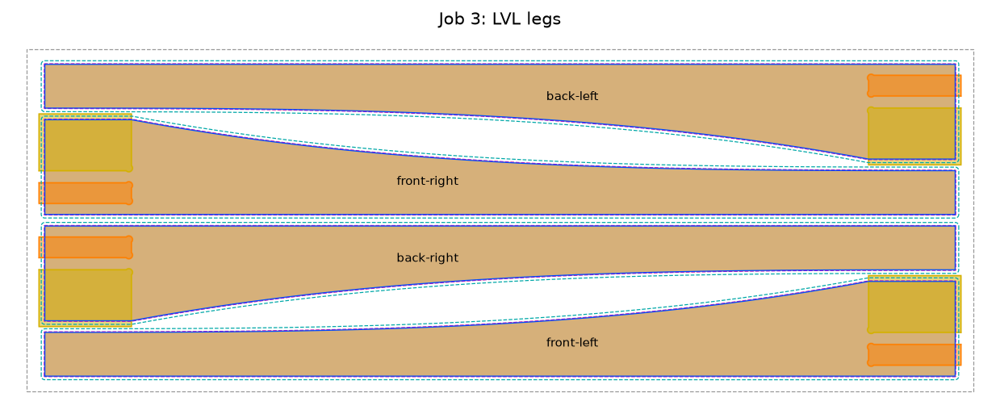

# Kitchen side table

A small side table for beside the kitchen: 31¾ × 23¾" and 32" tall. The back stands against the
wall. The front edge sweeps in an asymmetric curve, shallow at the left end as seen from the room.
It has four flared LVL legs, plywood aprons on all four sides, and a cherry top held by four glued
dowels at its middle and eight Z-clips. Every part is cut on a Shapeoko Pro XXL from files this
project generates.

The design and its reasons are in `docs/specs/2026-10-13-kitchen-side-table-design.md`, and the
build plan is in `docs/plans/`.



## Before you cut

1. Glue up the top (Assembly, step 1), then measure its width and depth. Set `TOP_WIDTH` and
   `TOP_DEPTH` in `table/spec.py`, and take both names out of `NOMINAL`.
2. Rebuild from the repo root: `tools/py projects/kitchen-side-table/build.py`. It prints the sizes,
   the LVL's depths, the pockets' and cut-outs' depths, and the dowel holes' depths and positions, and it writes nothing if any rule fails.

## Files

| File | Job | Stock, as it sits on the machine |
|---|---|---|
| `out/aprons.dxf` / `.svg` | 1 | Plywood, 32 × 11⅞ × 0.706", the worse face up |
| `out/fit_test.dxf` / `.svg` | 2 | An offcut of the LVL, at least 6 × 4" |
| `out/legs.dxf` / `.svg` | 3 | LVL faced to 1.62" thick, 32½ × 11¾, the worse face up |
| `out/top.dxf` / `.svg` | 4 | The cherry glue-up, show face up, curved edge toward you |
| `out/table.step` / `.glb` | – | The assembled table in 3D. Open the GLB in the CAD Viewer. |
| `out/previews/*.png` | – | Each job seen from above, with the parts named |

Every file is in inches, with its origin at the lower-left corner of the stock, seen from above.
Zero X and Y there, and Z on top of the stock.

## Layers and toolpaths (Carbide Create)

| Layer | Colour | Toolpath |
|---|---|---|
| `REFERENCE_STOCK` | grey | None. The stock's outline, to line up by. |
| `POCKET_HOUSING` | orange | Pocket, 0.75" deep |
| `POCKET_LAP` | yellow | Pocket, as deep as the plywood is thick: 0.706" |
| `GROOVE_CENTERLINE` | red | Contour, no offset, 5/16" deep |
| `CLEARANCE` | cyan | Contour, outside, 0.34" deep. Legs only. |
| `ROUGH` | magenta | Contour, outside, to full depth: 1.64". Legs only. |
| `CUT_OUTSIDE` | blue | Contour, outside, to full depth per job: plywood 0.726", top 0.77", legs 1.64" in two passes (to 1.3", then to 1.64"). |

The build prints every depth in this table for the measured stock and bits. If a measurement changes,
rebuild and use the new figures.

## Machining

These are starting settings; tune them by sound and chip.

| Job | Bit | Settings |
|---|---|---|
| 1 aprons | ¼" three-flute, 1" flute | 16,000 RPM, 50 IPM, 15 IPM plunge (ramp), 0.1" per pass. Tabs on the plywood parts. |
| 2 fit test | ¼" two-flute, set up as for job 3 | As job 3: the same bit, feeds and material as the leg pockets, so the test predicts them. |
| 3 legs | ¼" two-flute, 1.4" flute: ½" in the collet, 2" out | 12–14,000 RPM, 40 IPM, 10 IPM plunge (ramp), 0.05" per pass. Vacuum and air throughout. About 5 hours. |
| 4 top | ¼" three-flute | As job 1, with a full-depth finishing pass on the outline |

- **Hold-down:** painter's tape and CA glue under the LVL and the top. Their cuts go 0.02" into the
  spoilboard. The plywood is held by its tabs.
- **Leg tabs:** `legs.c2d` has 16 tabs, 0.17" high and 0.75" long, in two rows across the board,
  8½" and 24" from its left end: one on each long edge of each leg. They hold the legs and the
  slivers between them to each other and to the board's front and back edges, where you clamp.
  The rough pass and the last finish pass leave them; the other passes ignore them. If you
  re-import `legs.dxf`, add them again. Saw them off flush and sand.
- **Clamping the LVL:** clamp the front and back edges at 8½" and 24", where the tabs are. The
  legs sit centered across the board, so the cutter stays 0.148" inside each long edge (0.25" below
  the top half inch). At full depth the collet nut passes 0.36" above the board and reaches out past
  its edges, so no part of a clamp may stand more than about 5/16" above the board's top: grip the
  edges low. With the spindle off, jog the bit down to full depth beside each clamp and check.
- **Job 2 between jobs 1 and 3:** cut the aprons first, then the fit test, then the legs. Test with
  the coupon from job 1, or any offcut of the same plywood: only its thickness matters. It should
  slide into the test housing snug by hand, and sit flush in the test lap. If it is tight or loose in the housing, change `FIT_CLEARANCE` in
  `table/spec.py`. If it sits proud or low in the lap, check Z zero, re-measure the plywood and set
  `PLY_THICKNESS`. Either way, rebuild and test again before you cut the LVL.
- **Job 3, in this order:** the pockets; the clearance pass; the rough pass; the outline to 1.3";
  then the outline from 1.3" to full depth. The clearance pass widens the top of each slot, so the
  bit's smooth shank never rubs once it goes deeper than the flutes.
- **Job 3, grip and clearance:** draw a marker line on the shank at the collet nut, and check it
  between steps. With the spindle off, jog the bit down beside the LVL until it touches the
  spoilboard, and check that the collet nut is about ⅜" above the top of the board.
- **Mark each leg** with its name in pencil as it comes off (see `out/previews/legs.png`). The
  pockets face into the table.

## Assembly

1. **Glue up the top.** Let the boards sit in the loft for a week or two first. Arrange the four
   boards with the grain front to back, and mark the front ends. Keep the biscuits between 2" and
   19" from the back ends so the cut doesn't expose them. Sand the panel smooth, then measure it
   (see "Before you cut").
2. **Cut jobs 1 to 4**, with the fit test before the LVL.
3. **Dry-fit the base.** The side aprons drop into the housings. The long aprons sit in the laps,
   flush with the legs' inside faces. Each apron's top edge is the one nearer its clip groove: the
   groove runs ⅜" below the top edge, on the inside face, which faces into the table.
4. **Glue the end frames:** each end's front leg, back leg and side apron. Check they're square.
5. **Drill the long aprons' dowel holes** before they go in: two per apron, in the top edge, 5/16"
   wide. The positions and the 1-1/16" depth are what the build prints; nominally they are 1-1/16"
   deep and 12⅜" and 14⅜" from either end (an inch either side of the middle), centered on the plywood's thickness. A doweling jig keeps them square. Then glue the
   long aprons into their laps, with two screws each from inside.
6. **Finish.** Ease every edge by sanding. Seal the top's end-grain front and back edges first, so
   they don't darken more than the face. Put polyurethane on every face, the top's underside
   included, so both sides take up moisture alike and the top stays flat. Tape off the dowel holes
   and the 2" of apron edge between them.
7. **Attach the top.** Lay it upside down on a blanket. Put dowel centers in the four apron holes,
   set the base upside down on the top in its place (legs' outer faces 1" in from each end, back
   legs' back faces 3⅓" from the back edge), and press to mark the top. Drill the four marks 5/16"
   wide and as deep as the build prints (½" nominal), with a stop collar so the bit can't go through. Glue the dowels in, with glue
   only in the holes and on the 2" of apron edge between them; glue anywhere else would lock the
   top. Fit eight Z-clips in the grooves with ⅝" screws: one in each long-apron groove, two in each
   side apron's.

The top grows and shrinks about ⅛–¼" across its width with the seasons. Fixed only at the middle,
it moves half that each way, and the clips slide.

## Code

Python, run from the repo root through `tools/py`:

```bash
tools/py -m pytest projects/kitchen-side-table -q   # tests
tools/py projects/kitchen-side-table/build.py       # regenerate out/
```

`AGENTS.md` describes how the code is laid out and the rules it keeps.
